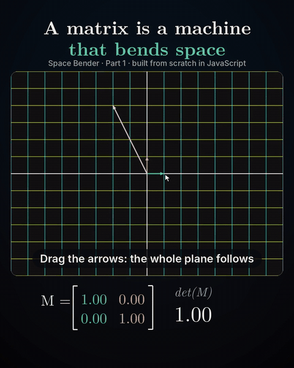

# Space Bender

**A matrix is a machine that bends space.** Space Bender is an interactive linear algebra lab, built from scratch in plain JavaScript and the HTML canvas, with no libraries.

Full demo video: [`media/space_bender_part1.mp4`](media/space_bender_part1.mp4)

## What you can do (Part 1)

- **Drag the basis vectors î and ĵ.** Every point in the plane follows, because the columns of a 2×2 matrix are exactly where î and ĵ land.
- **Watch a test vector move.** The pink arrow shows where a fixed vector lands: always −2·î + 4·ĵ.
- **Rotate 90°, shear, reset.** Each button multiplies a new matrix into the current one and animates the change smoothly.
- **Read the matrix and determinant live.** The side panel updates as you drag. Line î and ĵ up and the determinant hits 0: the plane collapses onto a line, which is why that matrix has no inverse.

## The math inside

| Feature | Idea |
| --- | --- |
| Moving the grid | Matrix × vector, row × column: `(a b; c d)·(x, y) = (ax + by, cx + dy)` |
| Arrow tips | The columns of `m`: î → `(m[0], m[2])`, ĵ → `(m[1], m[3])` |
| Stacking transformations | Matrix × matrix. The newest one goes on the left (`R · m`), because the matrix closest to the vector acts first |
| Rotation | `R(θ) = (cos θ  −sin θ ; sin θ  cos θ)` |
| Smooth animation | Linear interpolation `start + t·(target − start)`, except rotations, which blend the angle (`R(90°·t)`) so the grid doesn't shrink mid-turn |
| Arrowheads | `atan2` gives the arrow's angle. The head's corners are the tip minus a short step at angles `a ± 0.4` |
| Determinant | `det = ad − bc`: how much the transformation scales area |

## Run it

No build step. Clone the repo and open `index.html` in a browser, or use the VS Code **Live Server** extension.

`test.html` is a minimal standalone example of the animation loop (`requestAnimationFrame` + linear interpolation) that the main app is built on.

## Roadmap

- [x] **Part 1:** 2D transformation lab: dragging, rotate, shear, animation, live determinant
- [ ] **Part 2:** composition, why AB ≠ BA, shown side by side
- [ ] **Part 3:** inverse "rewind", and why det = 0 can't be undone
- [ ] **Part 4:** 3D version with three.js
- [ ] **Part 5:** watching a small neural network bend space, layer by layer

## Credits

Inspired by 3Blue1Brown's *Essence of Linear Algebra* series.

Built by [Salman Kiwan](https://github.com/Salman-Kiwan), a Computer Science student at Le Cnam Liban, while studying matrices for an Advanced Mathematics course.
